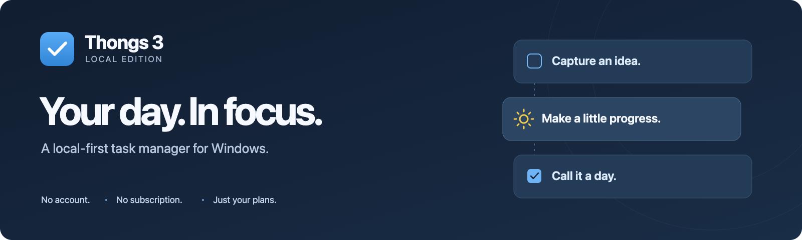
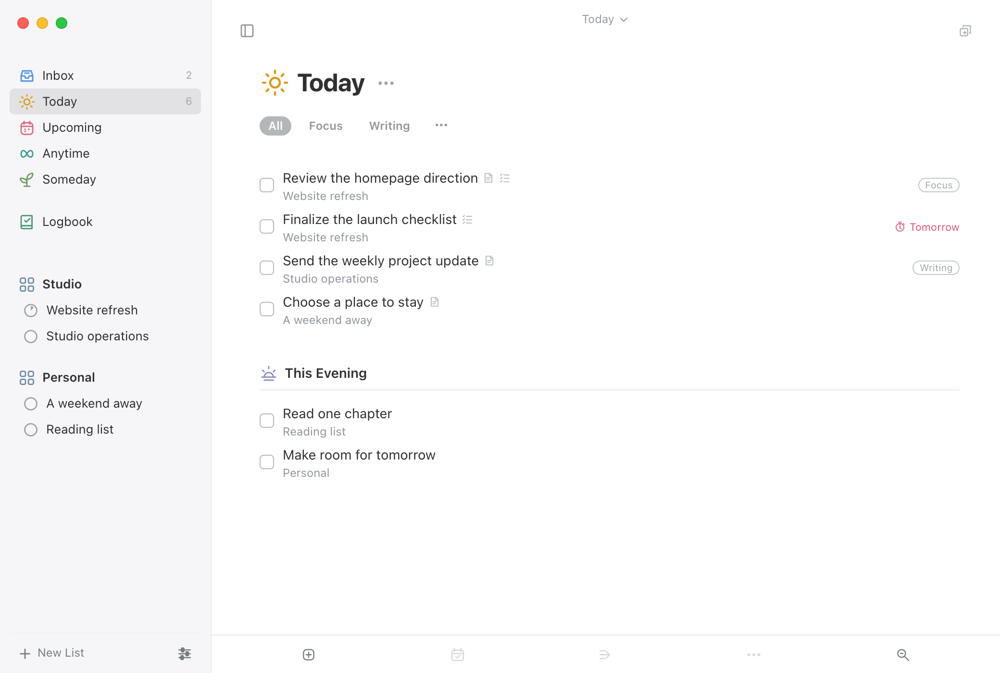
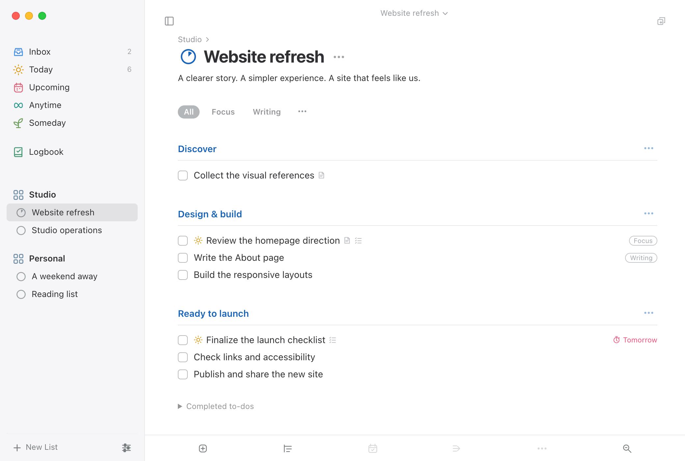
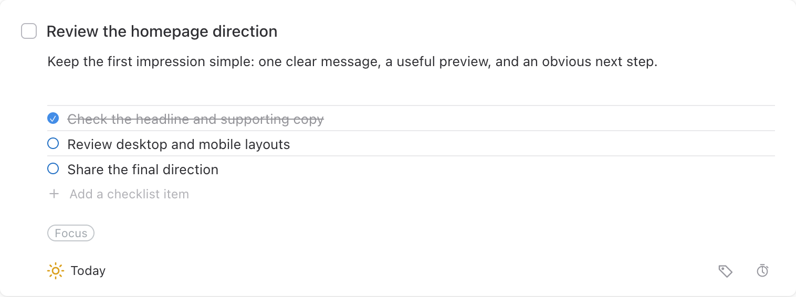
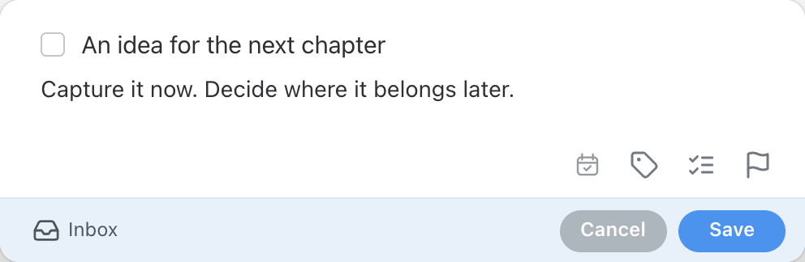

<p align="center">
  
</p>

<p align="center">
  <strong>Make room for what matters. Keep your plans on your own computer.</strong><br>
  Capture ideas, organize projects, and focus on today—without an account or an internet connection.
</p>

<p align="center">
  
  
  
</p>

<p align="center">
  <a href="#features">Features</a> ·
  <a href="#a-closer-look">Screenshots</a> ·
  <a href="#availability">Availability</a> ·
  <a href="#privacy--backups">Privacy</a> ·
  <a href="#project-status">Project status</a>
</p>

> [!WARNING]
> **Experimental preview—known data-loss risk.** A newly entered task can disappear with a second window open. Use disposable example data only, not important tasks. This is not a stable release. See [verification notes](docs/VERIFICATION.md).

<p align="center">
  <a href="https://github.com/patelthakkar/Thongs/releases/download/v0.2.0/Thongs-Local-0.2.0-Windows-x64.exe"><strong>Download 0.2.0 · Windows x64</strong></a><br>
  <sub><a href="https://github.com/patelthakkar/Thongs/releases/tag/v0.2.0">Release notes and SHA-256</a></sub>
</p>

<picture>
  <source media="(prefers-color-scheme: dark)" srcset="docs/assets/today-dark.png">
  
</picture>

<p align="center"><sub>Your priorities for the day, with a little space for the evening. Fictional demo content.<br>Open full size: <a href="docs/assets/today-light.png">Light</a> · <a href="docs/assets/today-dark.png">Dark</a></sub></p>

## Features

- **A place for every plan.** Capture in Inbox, focus in Today, look ahead in Upcoming, and keep future ideas in Anytime or Someday. Completed work moves to Logbook.
- **Projects with structure.** Group projects into areas, break them into headings, and track progress as you complete to-dos.
- **Details when you need them.** Add notes, checklists, tags, start dates, deadlines, and in-app reminders without losing the bigger picture.
- **Fast capture and search.** Use global Quick Entry to save an idea without switching away from your work. Quick Find reaches tasks, lists, tags, notes, and checklists.
- **Routines that repeat.** Repeat after completion or on a fixed schedule, with weekly, monthly, and yearly rules, pause/resume, and next-date overrides.
- **A desktop that fits your day.** Light, dark, and system appearance, automatic local saving, and portable JSON backups.

## A simple workflow

1. **Capture first.** Put a thought in Inbox or use Quick Entry. You can organize it later.
2. **Give it a home.** Move related to-dos into a project, add a heading, and set a date only when it helps.
3. **Focus on today.** Choose what matters now, leave evening plans for later, and let Logbook hold what is done.

## A closer look

### From a big idea to clear next steps

Areas keep work and personal plans separate. Projects bring the related tasks together; headings make the next step easier to see.

<picture>
  <source media="(prefers-color-scheme: dark)" srcset="docs/assets/project-dark.png">
  
</picture>

<p align="center"><sub>Open full size: <a href="docs/assets/project-light.png">Light</a> · <a href="docs/assets/project-dark.png">Dark</a></sub></p>

### Enough detail to move forward

Keep the context and the checklist with the task—not in a separate document you have to find again.

<picture>
  <source media="(prefers-color-scheme: dark)" srcset="docs/assets/task-detail-dark.png">
  
</picture>

### Catch an idea without breaking your flow

Quick Entry gives a passing thought a place to land. Add the essentials, choose a destination, and get back to what you were doing.

<p align="center">
  <picture>
    <source media="(prefers-color-scheme: dark)" srcset="docs/assets/quick-entry-dark.png">
    
  </picture>
</p>

The images above are captures of the app's actual interface, rendered with fictional demo data—not design mockups. They are browser-rendered previews, not proof of native Windows behavior. See [visual notes](docs/VISUALS.md).

## Availability

**A 0.2.0 build is available:** [v0.2.0](https://github.com/patelthakkar/Thongs/releases/tag/v0.2.0). It adds the close-to-taskbar prompt, tray residency, and the **Exit to taskbar** setting to the `0.1.0` Windows shell, so Quick Entry keeps working after the window is closed. It does **not** fix the known multi-window persistence failure. Download it only for evaluation with disposable data.

### Installation

1. Download the [Windows x64 executable](https://github.com/patelthakkar/Thongs/releases/download/v0.2.0/Thongs-Local-0.2.0-Windows-x64.exe). The SHA-256 is in the [release notes](https://github.com/patelthakkar/Thongs/releases/tag/v0.2.0).
2. In PowerShell, check the downloaded executable:

   ```powershell
   Get-FileHash .\Thongs-Local-0.2.0-Windows-x64.exe -Algorithm SHA256
   ```

   Compare the result with the SHA-256 in the release notes. If it differs, do not run the file.
3. Double-click the executable. No installer, Node.js installation, account, or runtime internet connection is required.

The build targets **Windows 10/11, 64-bit**. The executable is unsigned; Windows may show a security warning or block execution. Verify its origin and checksum, and do not disable security protections or bypass organizational policy to launch it. Export a separate backup before trying this build with an existing local library.

### Build from source

The Windows desktop shell and the packaging steps are published in [`windows/`](windows/README.md). The renderer is included there as a compiled bundle, so cloning this repository and following [BUILD.md](windows/BUILD.md) reproduces the packaged application, but the renderer's development source is still not published.

## Privacy & backups

- **Local storage.** Your library is saved as JSON in the app's application-data folder, with a previous-save backup.
- **No app telemetry.** The local build has no analytics, account system, or application network requests.
- **Portable backups.** Export and import ordinary JSON files from **Settings → Local Library**. Import replaces the current library, so export a backup first.
- **Plain text, not a vault.** JSON backups are not encrypted. Treat your library and exported files as sensitive, and keep a separate backup somewhere you trust.

Cloud sync, shared lists, connected calendars, mail capture, and mobile apps are outside this build's scope.

## Project status

**Early-stage local build · version 0.2.0.** The interface and core workflows are implemented, but this is not a production-certified Windows release.

The `0.1.0` shell passed **38 model checks**, **31 browser scenarios**, **11 macOS Electron checks**, and a package audit verifying that all 72 extracted graphics have original replacements and that dependency notices are included. Windows-executable testing under CrossOver exercises core workflows but **fails a multi-window persistence check**: a newly entered task can disappear after another window is opened.

The `0.2.0` build changes only the Windows shell (close-to-taskbar, tray, Quick Entry) and was rebuilt on Windows 11 with Electron 45.0.0. It was smoke-tested for the first-close prompt, tray hide, Quick Entry, the Settings toggle, and the reported version. The full suite and the CrossOver persistence test were not rerun for `0.2.0`; the multi-window failure remains. See [verification notes](docs/VERIFICATION.md).

Known limitations:

- Reminders fire while the app is running, including after the window is closed to the taskbar; they do not fire after **Quit**.
- Multi-window editing is not currently safe for important data. Same-field conflict resolution is latest-save-wins, and a separate pending-save failure is under investigation.
- Fonts, native controls, and some focus, hover, error, and animation states are not fully validated.

### Feedback

Have a question or spotted something unclear? [Open an issue](https://github.com/patelthakkar/Thongs/issues/new). For a bug report, include the build version, Windows version, steps to reproduce, and what you expected. Remove personal task content from screenshots and logs; do not attach your library or backup files.

## License & attribution

The Windows desktop shell is published in [`windows/`](windows/README.md); the renderer ships there as compiled output. The [binary use license](LICENSE-BINARY.txt) permits running a published build for personal and internal business use; it does not grant an open-source license or permission to redistribute the application. Electron packages necessarily include executable JavaScript, so a published shell is not a promise of protection against reverse engineering.

The banner and replacement interface graphics are original project artwork, not recolored vendor assets. React, React DOM, Scheduler, Lucide, Electron, and Chromium retain their own licenses; see [third-party notices](THIRD-PARTY-NOTICES.txt).

Thongs 3 is an independent project inspired by Things 3, with a name that takes itself a little less seriously. It is not affiliated with, endorsed by, or an official Windows version of Things or Cultured Code. See [visual notes](docs/VISUALS.md) for image provenance.
